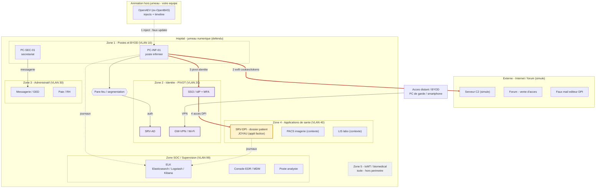

# Architecture - P13-H : infostealer en milieu hospitalier

Projet 4A STI - Simulation de cyberattaques.
Cible : vol d'identifiants via postes soignants / BYOD, pivot par l'identite, acces au dossier patient (DPI).

> Simulation uniquement : jumeau virtuel, services factices (dont le DPI), donnees fictives.
> Aucun vrai malware, aucun logiciel de sante ni donnee patient reelle.

## Deux couches

- **Vue logique** : zones par fonction, pour raconter l'attaque et les enjeux.
- **Vue reseau** : segments VLAN et VM, pour deployer le jumeau dans Ludus.

## Zones

| Zone | VLAN | Role |
|---|---|---|
| Postes & BYOD | 10 | Point d'entree : l'infostealer vole cookies, mots de passe, jetons SSO |
| Identite (pivot) | 20 | AD, SSO/IdP + MFA, VPN/Wi-Fi - le coeur du scenario |
| Administratif | 30 | Messagerie, GED, paie/RH |
| Applications de sante | 40 | **DPI (joyau)** ; PACS / LIS en contexte, non deployes |
| IoMT / biomedical | - | Hors perimetre, isole (non deploye) |
| SOC / Supervision | 99 | ELK, console EDR/MDM, poste analyste |

La segmentation est a la fois une barriere a franchir pour l'attaquant et une mesure de
defense a evaluer : un poste de soins compromis ne doit pas ouvrir un acces direct au DPI.

## Chemin d'attaque (timeline des injects)

Horloge acceleree : l'exercice complet tient en 3h (debrief a la fin de la 3e heure).

| Temps | Evenement |
|---|---|
| T+0 | Infection d'un poste de soins (faux update) |
| T+10 | Exfiltration des cookies et jetons SSO (alerte EDR, egress) |
| T+30 | Reutilisation de la session SSO depuis une IP inhabituelle (pivot) |
| T+50 | Acces au DPI hors perimetre, consultation massive de dossiers fictifs |
| T+75 | Annonce de vente sur le forum, escalade direction / DPO / communication |
| T+90 | Decision de crise : revocation des sessions, coupure SSO, mode degrade, notification CNIL (72 h) |
| T+90 -> T+150 | Remediation : nettoyage / reimage des postes, rotation des secrets, retour nominal |
| T+150 -> T+180 | Debrief et analyse : MTTD, MTTR, couverture de detection |

## Chaine d'outils

Renseignement prepare a la main (ANSSI/CERT-FR, MITRE ATT&CK)
-> **OpenAEV** (ex-OpenBAS) : injects + timeline de l'exercice
-> **Ludus** : jumeau numerique (VM, VLAN, pare-feu) sur Proxmox
-> **ELK** : collecte des journaux, detection, et base du volet analyse / data science.

L'infrastructure d'animation (OpenAEV) est separee du jumeau defendu : l'equipe anime
l'attaque, le SOC (joueurs) observe ELK et reagit.

